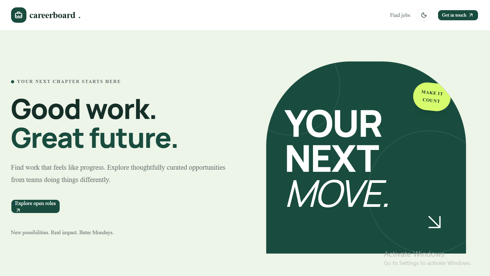

# Careerboard - Next.js Job Board

Careerboard is a responsive job board application built with Next.js. It allows candidates to browse job opportunities, search and filter listings, view job details, and submit applications through an application form.

The project focuses on building a practical full-stack application with reusable React components, API routes, form validation, responsive UI, and light/dark theme support.



<p align="center">
  <a href="https://github.com/cyberar/job-board-application">View Repository</a>
  ·
  <a href="https://github.com/cyberar/job-board-application/issues">Report a Bug</a>
  ·
  <a href="https://github.com/cyberar/job-board-application/issues">Request a Feature</a>
</p>

---

## Table of Contents

- [About Careerboard](#about-careerboard)
- [Features](#features)
- [Technology Stack](#technology-stack)
- [Getting Started](#getting-started)
  - [Prerequisites](#prerequisites)
  - [Installation](#installation)
  - [Running the Application](#running-the-application)
- [Application Routes](#application-routes)
- [API Documentation](#api-documentation)
- [How It Works](#how-it-works)
- [Project Structure](#project-structure)
- [Key Learning Points](#key-learning-points)
- [Future Improvements](#future-improvements)
- [Contributing](#contributing)
- [License](#license)

---

## About Careerboard

Careerboard is a job board application designed to provide candidates with a straightforward way to discover employment opportunities and submit applications.

Users can browse available jobs, search by job title or company, filter listings by employment type, and view detailed information about individual opportunities.

The application also includes an application form with client-side and server-side validation.

The current version uses local JSON data as its job listing data source. Application submissions are validated and logged by the API but are not yet stored in a persistent database.

## Features

- **Job Listings:** Browse available job opportunities.
- **Search Functionality:** Search jobs by title or company name.
- **Job Type Filtering:** Filter listings by full-time, part-time, contract, and internship opportunities.
- **Job Details:** View detailed descriptions, responsibilities, requirements, salary information, and other job information.
- **Application Form:** Submit applications with personal details, a cover note, and a resume URL.
- **Form Validation:** Client-side and server-side validation with field-specific error messages.
- **Loading States:** Loading skeletons while job data is being retrieved.
- **Error Handling:** Error messages, retry functionality, and appropriate 404 responses.
- **Responsive Design:** Layouts that adapt to desktop, tablet, and mobile screens.
- **Dark and Light Themes:** Switch between light and dark modes.
- **Reusable Components:** Shared components for job cards, job listings, forms, buttons, and theme controls.

## Technology Stack

| Technology | Purpose |
|---|---|
| Next.js 16 (App Router) | React framework and application routing |
| React 19 | UI development |
| TypeScript | Static typing |
| Tailwind CSS 4 | Styling and responsive layouts |
| shadcn/ui | Reusable UI components |
| Lucide React | Icons |
| next-themes | Light and dark theme management |
| Local JSON | Initial job listing data |
| Node.js | Server-side runtime |

---

## Getting Started

Follow these instructions to set up and run Careerboard locally.

### Prerequisites

Make sure you have the following installed:

- [Node.js](https://nodejs.org/) (20.9 or later)
- npm (included with Node.js), or another package manager such as Yarn, pnpm, or Bun.
- Git

### Installation

**1. Clone the repository**

```bash
git clone https://github.com/cyberar/job-board-application.git
```

**2. Navigate into the project directory**

```bash
cd job-board-application
```

**3. Install dependencies**

```bash
npm install
```

**4. Start the development server**

```bash
npm run dev
```

**5. Open the application**

Visit:

```text
http://localhost:3000
```

The application should now be running locally.

### Available Scripts

| Command | Description |
|---|---|
| `npm run dev` | Starts the development server |
| `npm run build` | Creates an optimized production build |
| `npm run start` | Starts the production server |
| `npm run lint` | Runs the configured linting script, if available |

---

## Application Routes

The application contains the following pages and routes:

| Method | Route | Description |
|---|---|---|
| GET | `/` | Homepage with searchable and filterable job listings |
| GET | `/jobs/[id]` | Individual job details and application form |

## API Documentation

Careerboard uses Next.js Route Handlers to expose API endpoints for retrieving job listings and submitting applications.

### Available Endpoints

| Method | Endpoint | Description |
|---|---|---|
| GET | `/api/jobs` | Retrieves all available jobs |
| GET | `/api/jobs?q=engineer` | Searches jobs by title or company |
| GET | `/api/jobs?type=Full-time` | Filters jobs by employment type |
| GET | `/api/jobs?q=engineer&type=Full-time` | Combines search and employment type filtering |
| GET | `/api/jobs/[id]` | Retrieves a single job by its ID |
| POST | `/api/apply` | Validates and processes an application submission |

### Example: Fetch All Jobs

```bash
curl http://localhost:3000/api/jobs
```

### Example: Search and Filter Jobs

```bash
curl "http://localhost:3000/api/jobs?q=engineer&type=Full-time"
```

### Example: Fetch a Single Job

```bash
curl http://localhost:3000/api/jobs/1
```

### Example: Submit a Job Application

```bash
curl -i -X POST http://localhost:3000/api/apply \
  -H "Content-Type: application/json" \
  -d '{
    "jobId": "1",
    "name": "Jane Doe",
    "email": "jane@example.com",
    "coverNote": "I would be a great fit for the team.",
    "resumeUrl": "https://example.com/cv"
  }'
```

### Validation Error Response

When submitted data is invalid, the API returns a validation error with field-specific messages.

```json
{
  "code": "VALIDATION_ERROR",
  "message": "Please correct the highlighted fields.",
  "fields": {
    "email": "Enter a valid email address."
  }
}
```

### Application Submission Behaviour

The application API independently validates submitted data on the server, even when client-side validation has already been performed.

In the current implementation:

- Valid submissions receive a successful response.
- Invalid submissions return appropriate validation errors.
- Accepted application data is logged server-side.
- Personally identifiable fields are redacted in console logs.
- Applications are not yet stored in a database.
- Email notifications are not currently implemented.

---

## How It Works

### 1. Job Data Management

Job listings are stored in `data/jobs.json`.

The `lib/jobs.ts` module provides the server-side logic for accessing and retrieving job data. UI components do not import the JSON file directly; they retrieve job information through the API endpoints.

### 2. Search and Filtering

The jobs API supports optional query parameters:

- `q`: Searches job titles and company names without case sensitivity.
- `type`: Filters jobs by employment type.

Both filters can be used together. Results are sorted by posting date, with the newest listings appearing first.

### 3. Job Details

When a candidate selects a job, the application navigates to `/jobs/[id]`.

The job details page retrieves the selected job through the individual job API endpoint and displays its information.

If a job does not exist, the application displays a not-found state.

### 4. Application Submission

Candidates can submit their details through the application form.

The form validates required fields and email format on the client before sending the application to `/api/apply`.

The server performs its own validation before accepting the submission.

### 5. Loading and Error Handling

The application includes:

- Loading skeletons while data is being fetched.
- Error messages and retry functionality.
- Empty states when no jobs match a search.
- Abortable fetch requests to prevent unnecessary updates.
- Debounced search requests to reduce excessive API calls.
- Appropriate handling of missing job records.

### 6. Responsive Interface and Themes

Tailwind CSS is used to build responsive layouts across desktop, tablet, and mobile devices.

The application also supports light and dark themes using `next-themes` and shared CSS design tokens.

---

## Project Structure

```text
job-board-application/
│
├── app/
│   ├── api/
│   │   ├── apply/
│   │   │   └── route.ts             # Application submission endpoint
│   │   └── jobs/
│   │       ├── [id]/
│   │       │   └── route.ts         # Retrieve a job by ID
│   │       └── route.ts             # Retrieve and filter jobs
│   │
│   ├── jobs/
│   │   └── [id]/
│   │       └── page.tsx             # Job details page
│   │
│   ├── globals.css                  # Global styles and theme variables
│   ├── layout.tsx                   # Root application layout
│   └── page.tsx                     # Homepage
│
├── components/
│   ├── ui/                          # Reusable UI components
│   │   └── button.tsx
│   ├── apply-form.tsx               # Application form
│   ├── job-card.tsx                 # Individual job card
│   ├── job-list.tsx                 # Job listing and filtering
│   ├── theme-provider.tsx           # Theme provider
│   └── theme-toggle.tsx             # Theme switcher
│
├── data/
│   └── jobs.json                    # Initial job listing data
│
├── lib/
│   ├── date.ts                      # Date formatting utilities
│   ├── jobs.ts                      # Job data access and utilities
│   └── utils.ts                     # Shared utility functions
│
├── public/
│   └── landing-page.PNG             # Application screenshot
│
├── package.json
├── package-lock.json
├── tsconfig.json
└── README.md
```

---

## Key Learning Points

Building Careerboard provided practical experience with several areas of modern web development:

- **Next.js App Router:** Working with pages, dynamic routes, layouts, and API Route Handlers.
- **REST API Development:** Creating GET and POST endpoints and handling request and response data.
- **TypeScript:** Defining types and interfaces to improve code consistency and catch potential errors.
- **React State Management:** Managing component state, form state, loading states, and error states with React hooks.
- **Data Fetching:** Retrieving data from API endpoints and handling asynchronous operations.
- **Form Validation:** Implementing client-side and server-side validation with meaningful error responses.
- **Reusable Components:** Breaking the application into smaller, maintainable components.
- **Responsive Design:** Using Tailwind CSS to create layouts that work across different screen sizes.
- **Theme Management:** Implementing light and dark modes.
- **Error Handling:** Handling failed requests, missing records, empty search results, and invalid form submissions.
- **User Experience:** Improving usability through loading skeletons, debounced search, and clear feedback.

---

## Future Improvements

The following features are planned for future versions of Careerboard:

- [ ] **Database Integration:** Replace local JSON data with PostgreSQL and implement persistent storage for jobs and applications.
- [ ] **Candidate Authentication:** Introduce secure user registration, login, and account management.
- [ ] **Application Tracking Dashboard:** Allow candidates to monitor their applications and track their progress.
- [ ] **Application Status Management:** Support application stages such as Wishlist, Applied, Interviewing, and Offer.
- [ ] **Drag-and-Drop Workflow:** Introduce a Kanban-style dashboard for managing application statuses.
- [ ] **Email Notifications:** Send application confirmation emails and relevant status updates.
- [ ] **Recruiter Dashboard:** Allow recruiters to create, update, and manage job listings.
- [ ] **Pagination:** Improve performance and navigation as the number of job listings grows.
- [ ] **URL-Based Search Filters:** Keep search queries and selected filters in the URL.
- [ ] **Security Improvements:** Add rate limiting, spam prevention, and stronger application abuse protection.
- [ ] **Automated Testing:** Introduce unit, integration, and end-to-end tests using tools such as Vitest and Playwright.
- [ ] **Monitoring and Observability:** Add application logging, error monitoring, and performance tracking.
- [ ] **Accessibility Improvements:** Conduct accessibility audits and improve keyboard navigation and screen-reader support.

---

## Contributing

Contributions, suggestions, and feature requests are welcome.

To contribute:

1. Fork the repository.
2. Create a feature branch:

   ```bash
   git checkout -b feature/your-feature-name
   ```

3. Make your changes.
4. Commit your changes:

   ```bash
   git commit -m "Add: your feature description"
   ```

5. Push your branch:

   ```bash
   git push origin feature/your-feature-name
   ```

6. Open a Pull Request.

For bugs or feature requests, please use the [GitHub Issues](https://github.com/cyberar/job-board-application/issues) page.

---

## License

This project is currently a personal project. A formal open-source license has not yet been specified.

---

<p align="center">
  Built with Next.js, TypeScript, and Tailwind CSS.
</p>

<p align="center">
  <a href="#readme-top">Back to Top ↑</a>
</p>